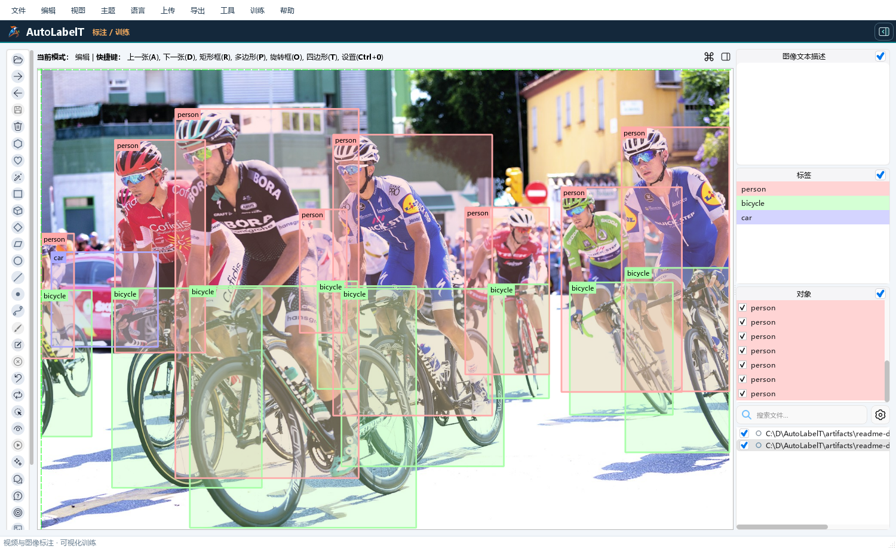
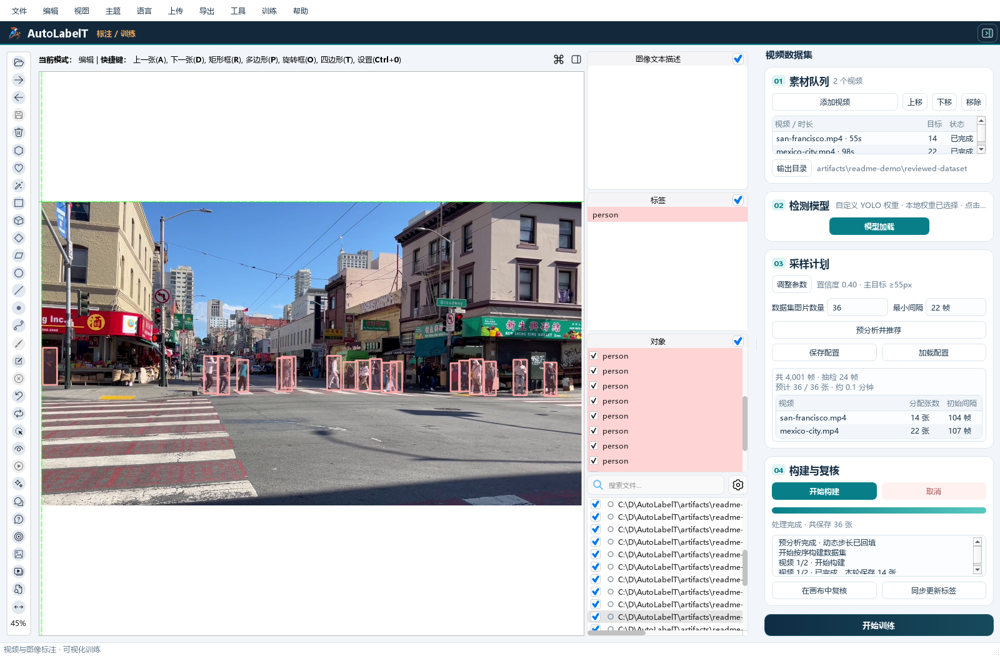
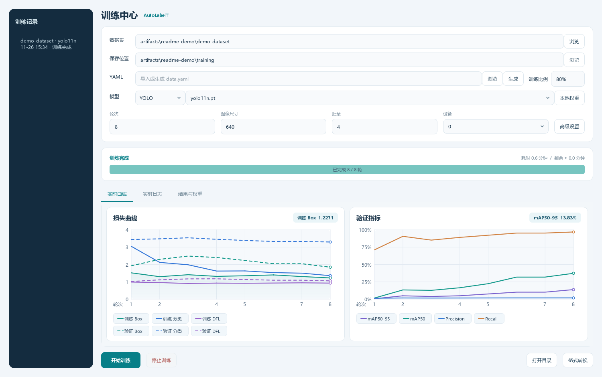

<div align="center">
  
  <h1>AutoLabelT</h1>
  <p><strong>视频建集、图像标注与目标检测训练工作台</strong></p>
  <p>
    <a href="pyproject.toml"></a>
    <a href="LICENSE"></a>
  </p>
  <p>
    <a href="#核心功能">核心功能</a> ·
    <a href="#快速开始">🚀 快速开始</a> ·
    <a href="#使用流程">使用流程</a> ·
    <a href="#数据集输出">数据集输出</a> ·
    <a href="#模型支持">模型支持</a> ·
    <a href="#文档与贡献">文档与贡献</a>
  </p>
</div>

**AutoLabelT** 把视频素材变成可检查、可编辑、可训练的目标检测数据集。可以从多段视频中筛选含目标的画面并生成初始标注，也可以打开已有图片或 YOLO 数据集，从补标、复核或训练开始。

**视频或图像 → 自动标注 → 画布复核 → 同步 YOLO 标签 → 训练与 ONNX 导出**



## 核心功能

| 功能 | 可以做什么 |
| --- | --- |
| 🎬 **视频批量建集** | 设置目标张数和最小帧间隔，预分析每段视频能贡献多少样本，再按目标高度、小目标占比和动态步长筛选画面。 |
| 🏷️ **自动标注与补标** | 用本地模型或预训练模型生成初始框，或从已有结果继续补标，保留已经修正过的标注。 |
| 🔍 **复核与标签同步** | 在画布上查看、修改或删除检测框，检查低置信度目标，再把保存的复核结果同步回 YOLO TXT。 |
| 📈 **训练与模型导出** | 为 YOLO 或 RT-DETR 准备数据划分，查看损失、验证指标和训练日志，完成后导出 ONNX。 |

## 快速开始

准备好 Git 和 Conda。以下命令会创建 Python 3.11 环境、安装应用和模型依赖，并启动桌面工作台。

```bash
git clone https://github.com/cw-goo/AutoLabelT.git
cd AutoLabelT
conda env create --file environment.yml
conda activate autolabel
autolabelt
```

启动后可直接打开图片手工标注。需要自动检测时，从本地导入权重，或在应用中下载受管模型。初次使用视频工作流，可先用一段短视频预分析，确认类别和采样参数后再添加更多素材。

<details>
<summary>更新环境、GPU 和安装包</summary>

- **已有环境**可在仓库根目录运行 `conda env update --file environment.yml`。Windows x64 或 Linux x86-64 的旧环境若安装过 CPU 版 ONNX Runtime，更新前先移除旧运行时。CPU 和 GPU 发行包共用 `onnxruntime` 模块。
- **GPU 加速**需要兼容的驱动和运行库。Conda 配置在 Windows x64 和 Linux x86-64 上安装 CUDA 版 PyTorch。支持 CPU 的模型也可在 CPU 上运行，训练设备可在训练中心选择。
- **安装包**由 Python wheel 和安装脚本组成，首次安装需要联网。详见 [Windows 安装说明](packaging/windows/INSTALL.txt) 和 [Linux 安装说明](packaging/linux/INSTALL.txt)。

</details>

## 使用流程

### 从视频生成数据集

1. **准备素材和模型。** 在“视频数据集”面板添加视频、安排处理顺序并选择输出目录。打开“模型加载”，设置检测类别，加载权重后测试模型。
2. **预分析并确认。** 首次可试设目标为 **100 张**、最小间隔为 **25 帧**。点击“预分析并推荐”查看各视频的分配与初始间隔，再到“调整参数”确认。张数设为 `0` 时，应用会按动态步长扫描。
3. **构建并复核。** 开始构建后可查看保存数量和淘汰原因。选中样本进入画布，调整位置不准的框、删除误检或补上漏标。
4. **同步训练标签。** 保存复核结果后，点击“同步更新标签”，将修改写回对应的 YOLO TXT。数据集仍保留样本的来源视频、帧号和运行配置。

指定张数时，应用会根据各段视频的合格率调整分配并补采。合格样本不足时，任务会显示实际张数和缺口。 [视频批量处理指南](docs/video-batch.zh-CN.md)



### 为已有图片标注、补标和复核

打开图片目录即可在画布上绘制或编辑标注。已有 YOLO 检测数据集时，可打开包含 `images/`、`labels/` 和 `classes.txt` 的目录并继续处理。

- **生成初始标注**时，先确认模型与类别映射，再运行图片自动标注。
- **保留已有工作**时，在“自动运行”中选择“保留旧标注，只补漏标”。应用按交并比判断新框与旧框的重叠程度，默认阈值为 `0.60`。
- **复核完成**后，把画布上的更改保存到 JSON，再按数据集要求同步或导出 YOLO 标签。


### 训练模型并导出 ONNX

1. 从右侧边栏打开训练中心，选定已复核的数据集。可导入已有的 `data.yaml`，也可在界面里设置训练比例并生成数据划分。
2. 选择 **YOLO** 或 **RT-DETR**，设置轮次、图像尺寸、批量和设备。运行时可查看训练与验证损失，以及 Precision、Recall、mAP 和日志。
3. 在“结果与权重”中查看 `best.pt` 和 `last.pt`，通过“格式转换”导出 ONNX。 [训练中心指南](docs/training.zh-CN.md)



## 数据集输出

视频构建会在所选输出目录生成图片、训练标签和复核记录。类别由 `classes.txt` 的行顺序确定，样本来源和框分数可在元数据中查阅。

```text
dataset/
├── images/       # JPG 样本与同名复核 JSON
├── labels/       # YOLO TXT 训练标签
├── classes.txt   # 类别名称，行号从 0 起对应类别 ID
├── configs/      # 运行配置与快照
└── metadata/     # 源视频、帧号、采样统计及逐框分数
```

YOLO TXT 每行使用 `class_id center_x center_y width height`，坐标按图像尺寸归一化。复核同步按图片的相对路径写回标签，例如 `images/train/frame.jpg` 对应 `labels/train/frame.txt`。没有复核 JSON 的图片会保留原有 TXT。

## 模型支持

以下是视频工作流已注册的模型。图片标注使用工作台内的独立模型目录，本地 YOLO 图片模型可按权重顺序配置多个类别。

| 视频模型 | 类别和使用条件 |
| --- | --- |
| 本地 YOLO `.pt` | 视频基线读取类别 ID `0`，输出为 `person`。 |
| COCO 预训练 YOLO | 从权重已包含的 COCO 类别中选择。 |
| YOLO-World | 按文本提示检测，依赖 `yolo-world`。 |
| Grounding DINO Tiny / Base | 按文本类别检测，依赖 `multimodal`。 |
| Florence-2 | 支持文本提示检测，依赖 `multimodal`，需显式确认信任固定版本模型代码。 |
| SAM 3 / 3.1 | 将文本提示分割结果转为矩形框，需取得权重访问授权。 |

开放词汇模型的文本类别顺序决定输出 ID。通过 Conda 环境文件安装时已包含上表的可选依赖。用 pip 安装的环境可按需运行 `python -m pip install -e ".[multimodal]"` 或 `python -m pip install -e ".[yolo-world]"`。

## 文档与贡献

- 设置目标张数、调整采样计划和理解补采规则。 [视频批量处理](docs/video-batch.zh-CN.md)
- 划分训练集与验证集、监控训练并导出 ONNX。 [可视化训练中心](docs/training.zh-CN.md)
- 查阅算法基线、标注同步和数据保护机制。 [架构说明](docs/architecture.zh-CN.md)
- 查找生成文件并构建分发包。 [本地输出与构建说明](docs/artifacts.md)

提交改动前请阅读 [贡献指南](AGENTS.md)。反馈问题时，请附上操作系统、Python 版本、模型名称、复现步骤及相关日志。 [GitHub Issues](https://github.com/cw-goo/AutoLabelT/issues)

```bash
python -m pip install -e ".[test]"
python -m pytest -q tests
```

## 致谢与许可

AutoLabelT 的标注工作台基于 **X-AnyLabeling 4.2.0**，源码位于 `autolabel/workbench/`，保留上游作者和许可声明。感谢上游项目及其贡献者。 [X-AnyLabeling](https://github.com/CVHub520/X-AnyLabeling)

本项目采用 **GPL-3.0** 许可。第三方组件和模型权重适用各自的许可及访问条件。 [许可证](LICENSE) · [第三方声明](THIRD_PARTY_NOTICES.md)

### 演示素材

- **照片**由 Quino Al 和 Aanya Chakravarti 拍摄。 [自行车赛](https://unsplash.com/photos/bike-race-on-street-during-daytime-D3sfNUXLVFc) · [城市街口](https://unsplash.com/photos/busy-city-street-with-pedestrians-and-cars-kvaaDtr4csU) · [Unsplash 许可](https://unsplash.com/license)
- **视频**由 David McBee 和 Israyosoy S. 拍摄。 [旧金山街景](https://www.pexels.com/video/a-city-street-with-cars-and-pedestrians-crossing-the-street-26732129/) · [墨西哥城街景](https://www.pexels.com/video/a-city-street-with-cars-and-people-walking-20474313/) · [Pexels 许可](https://www.pexels.com/license/)
