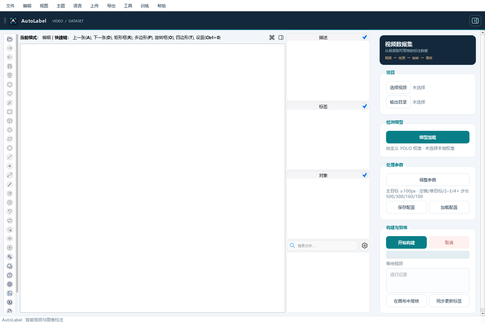

<div align="center">
  
  <h1>AutoLabelT</h1>
  <p><strong>从原始视频到目标检测模型的桌面工作台</strong></p>
  <p>
    <a href="pyproject.toml"></a>
    <a href="LICENSE"></a>
  </p>
  <p>
    <a href="#快速开始">快速开始</a> ·
    <a href="#使用流程">使用流程</a> ·
    <a href="#数据集输出">数据集输出</a> ·
    <a href="#模型支持">模型支持</a> ·
    <a href="#文档与贡献">文档与贡献</a>
  </p>
</div>

AutoLabelT 在同一个桌面应用里完成视频抽帧、图像标注、人工复核和模型训练。它根据检测到的目标数量调整采样步长，按目标高度和小目标占比筛选画面。已有图片或 YOLO 数据集也可直接进入标注和训练流程。

**批量视频 → 筛选样本并生成标注 → 画布复核 → YOLO / RT-DETR 训练 → ONNX 导出**



## 快速开始

准备好 Git 和 Conda，在终端运行以下命令。环境文件会创建 Python 3.11 环境并安装应用及常用模型依赖。

```bash
git clone https://github.com/cw-goo/Autolabel.git
cd Autolabel
conda env create --file environment.yml
conda activate autolabel
autolabelt
```

启动后，可以直接打开图片开始手工标注。视频自动标注需要先加载检测权重。权重可从本地导入，部分模型也可在应用中下载。

<details>
<summary>更新环境、GPU 和安装包</summary>

- **已有环境**可在仓库根目录运行 `conda env update --file environment.yml`。Windows x64 或 Linux x86-64 的旧环境若安装过 CPU 版 ONNX Runtime，更新前先移除旧运行时。CPU 和 GPU 发行包共用 `onnxruntime` 模块。
- **GPU 加速**需要兼容的驱动和运行库。Conda 配置在 Windows x64 和 Linux x86-64 上安装 CUDA 版 PyTorch。支持 CPU 的模型也可在 CPU 上运行，训练设备可在训练中心选择。
- **安装包**由 Python wheel 和安装脚本组成，首次安装需要联网。详见 [Windows 安装说明](packaging/windows/INSTALL.txt) 和 [Linux 安装说明](packaging/linux/INSTALL.txt)。

</details>

## 使用流程

### 从视频生成数据集

1. 在右侧“视频数据集”面板添加视频并选择输出目录。打开“模型加载”，选择检测模型、配置类别，再点击“测试模型”。受管模型需要先下载权重。
2. 首次可以试设目标为 **100 张**、最小间隔为 **25 帧**。点击“预分析并推荐”查看各视频的预计分配，再打开“调整参数”检查并点击“使用参数”。张数填 `0` 时按动态步长扫描。
3. 点击“开始构建”，查看样本数和淘汰原因。用“在画布中复核”检查标注并修正检测框，再点击“同步更新标签”，将复核结果写回 YOLO TXT。

指定张数时，软件会在合格样本不足的情况下记录缺口。批量分配、补采与采样参数见 [视频批量处理指南](docs/video-batch.zh-CN.md)。

### 为已有图片补标

在画布中打开图片目录或已有标注的数据集，例如带有 `images/`、`labels/` 和 `classes.txt` 的 YOLO 数据集。加载图片模型后，在“自动运行”中选择“保留旧标注，只补漏标”。补标会依据交并比（IoU，默认 `0.60`）跳过与现有框高度重叠的预测。结果保存为复核 JSON，可在检查后同步或导出 YOLO 标签。

### 训练模型并导出 ONNX

点击右侧边栏底部的“开始训练”，选择数据集，导入或生成 `data.yaml`，再选择 YOLO 或 RT-DETR 检测模型。训练期间可查看损失、Precision、Recall、mAP 和实时日志。训练完成后，在结果页找到 `best.pt`，用“格式转换”导出 ONNX。数据划分和训练选项见 [训练中心指南](docs/training.zh-CN.md)。

## 数据集输出

```text
dataset/
├── images/       # JPG 样本与同名复核 JSON
├── labels/       # YOLO TXT 训练标签
├── classes.txt   # 类别名称，行号从 0 起对应类别 ID
├── configs/      # 运行配置与快照
└── metadata/     # 源视频、帧号、采样统计及逐框分数
```

YOLO TXT 每行使用 `class_id center_x center_y width height`，坐标按图像尺寸归一化。复核同步按图片的相对路径写回对应标签，例如 `images/train/frame.jpg` 对应 `labels/train/frame.txt`。只有带复核 JSON 的图片参与写回。

## 模型支持

以下是视频工作流已注册的模型。图片标注使用工作台内的独立模型目录，本地 YOLO 图片模型可按权重顺序配置多个类别。

| 视频模型 | 类别和使用条件 |
| --- | --- |
| 本地 YOLO `.pt` | 视频基线读取类别 ID `0`，输出为 `person`。 |
| COCO 预训练 YOLO | 从权重已包含的 COCO 类别中选择。 |
| YOLO-World | 按文本提示检测，依赖 `yolo-world`。 |
| Grounding DINO Tiny / Base | 按文本类别检测，依赖 `multimodal`。 |
| Florence-2 | 支持文本提示检测，依赖 `multimodal`，需显式确认信任固定版本模型代码。 |
| SAM 3 / 3.1 | 将文本提示分割结果转为矩形框，需取得权重访问授权。 |

开放词汇模型的文本类别顺序决定输出 ID。通过 Conda 环境文件安装时已包含上表的可选依赖。用 pip 安装的环境可按需运行 `python -m pip install -e ".[multimodal]"` 或 `python -m pip install -e ".[yolo-world]"`。

## 文档与贡献

- 设置目标张数、调整采样计划和理解补采规则。 [视频批量处理](docs/video-batch.zh-CN.md)
- 划分训练集与验证集、监控训练并导出 ONNX。 [可视化训练中心](docs/training.zh-CN.md)
- 查阅算法基线、标注同步和数据保护机制。 [架构说明](docs/architecture.zh-CN.md)
- 查找生成文件并构建分发包。 [本地输出与构建说明](docs/artifacts.md)

提交改动前请阅读 [贡献指南](AGENTS.md)。反馈问题时，请附上操作系统、Python 版本、模型名称、复现步骤及相关日志。 [GitHub Issues](https://github.com/cw-goo/Autolabel/issues)

```bash
python -m pip install -e ".[test]"
python -m pytest -q tests
```

## 致谢与许可

AutoLabelT 的标注工作台基于 **X-AnyLabeling 4.2.0**，源码位于 `autolabel/workbench/`，保留上游作者和许可声明。感谢上游项目及其贡献者。 [X-AnyLabeling](https://github.com/CVHub520/X-AnyLabeling)

本项目采用 **GPL-3.0** 许可。第三方组件和模型权重适用各自的许可及访问条件。 [许可证](LICENSE) · [第三方声明](THIRD_PARTY_NOTICES.md)
