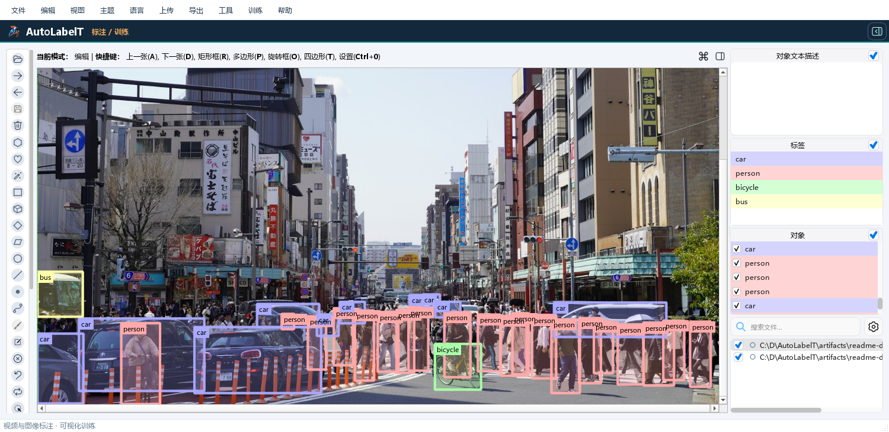

<div align="center">
  
  <h1>AutoLabelT</h1>
  <p><strong>视频建集、图像标注与目标检测训练工作台</strong></p>
  <p>
    <a href="pyproject.toml"></a>
    <a href="LICENSE"></a>
  </p>
  <p>
    <a href="#核心功能">核心功能</a> ·
    <a href="#快速开始">🚀 快速开始</a> ·
    <a href="#使用流程">使用流程</a> ·
    <a href="#数据集输出">数据集输出</a> ·
    <a href="#致谢与许可">致谢与许可</a>
  </p>
</div>

**AutoLabelT** 把视频素材变成可检查、可编辑、可训练的目标检测数据集。可以从多段视频中筛选含目标的画面并生成初始标注，也可以打开已有图片或 YOLO 数据集，从补标、复核或训练开始。

**视频或图像 → 自动标注 → 画布复核 → 同步 YOLO 标签 → 训练与 ONNX 导出**


## 核心功能

<table>
  <thead>
    <tr><th width="190">功能</th><th>可以做什么</th></tr>
  </thead>
  <tbody>
    <tr><td><strong>🎬 视频批量建集</strong></td><td>将多段视频排队处理，预估各段的采样张数，再按目标质量和动态步长筛选画面。</td></tr>
    <tr><td><strong>🏷️ 自动标注与补标</strong></td><td>用本地权重或接入的开源模型生成初始标注，也可保留已有标注并补充漏标。</td></tr>
    <tr><td><strong>🔍 复核与标签同步</strong></td><td>在画布上调整检测框、补框或删除误检，再将复核结果写回 YOLO TXT。</td></tr>
    <tr><td><strong>📈 训练与模型导出</strong></td><td>自动划分训练集和验证集并生成 YAML，查看训练曲线与日志，导出 ONNX。</td></tr>
  </tbody>
</table>

## 快速开始

准备好 Git 和 Conda。以下命令会创建 Python 3.11 环境、安装应用和模型依赖，并启动桌面工作台。

```bash
git clone https://github.com/cw-goo/AutoLabelT.git
cd AutoLabelT
conda env create --file environment.yml
conda activate autolabel
autolabelt
```

启动后可直接打开图片手工标注。需要自动检测时，从本地导入权重，或在应用中下载受管模型。初次使用视频工作流，可先用一段短视频预分析，确认类别和采样参数后再添加更多素材。

<details>
<summary>更新环境、GPU 和安装包</summary>

- **已有环境**可在仓库根目录运行 `conda env update --file environment.yml`。Windows x64 或 Linux x86-64 的旧环境若安装过 CPU 版 ONNX Runtime，更新前先移除旧运行时。CPU 和 GPU 发行包共用 `onnxruntime` 模块。
- **源码目录移动或更名后**，激活 `autolabel` 环境，在新的仓库根目录运行 `python -m pip install -e .`，让启动命令指向新位置。也可以在已安装的环境中用 `python -m autolabel` 启动。
- **GPU 加速**需要兼容的驱动和运行库。Conda 配置在 Windows x64 和 Linux x86-64 上安装 CUDA 版 PyTorch。支持 CPU 的模型也可在 CPU 上运行，训练设备可在训练中心选择。
- **安装包**由 Python wheel 和安装脚本组成，首次安装需要联网。详见 [Windows 安装说明](packaging/windows/INSTALL.txt) 和 [Linux 安装说明](packaging/linux/INSTALL.txt)。

</details>

## 使用流程

### 从视频生成数据集

1. **批量添加视频。** 在“素材队列”里一次选入多个视频，查看时长，用“上移”“下移”调整顺序。整批素材共用一个检测模型，生成的样本写入同一个输出目录。
2. **选择模型与类别。** 打开“模型加载”，选用本地检测权重，或从接入的开源模型中选择。配置需要检测的类别，下载或加载权重后点击“测试模型”。已有类别的模型按权重类别选择，支持文本提示的模型可输入要查找的目标。
3. **设置采样计划。** 在“采样计划”中填写数据集目标张数和同一视频内两张样本的最小帧间隔，例如 **100 张**、**25 帧**。张数设为 `0` 时，应用按动态步长扫描整批视频。先在“调整参数”中设定检测置信度、推理尺寸、目标最小高度和小目标占比等筛选条件。
4. **预分析并确认参数。** 点击“预分析并推荐”，应用沿每段视频的时间轴分散抽检，估算目标数量分布和画面合格率。查看各段预计分配的张数与初始采样间隔，再打开“调整参数”检查或修改回填的动态步长，然后点击“使用参数”确认。调整检测或质量条件后，构建会按确认后的设置重新抽检。
5. **构建并在画布中复核。** 选择输出目录并点击“开始构建”。应用按队列顺序检测、筛选和保存样本，按实际合格率调整采样密度，必要时补采或重新分配张数。运行面板显示保存数量和淘汰原因，素材不足时显示与目标的差距。样本生成后可在画布中逐张检查，移动或缩放检测框、删除误检并补齐漏标。
6. **同步训练标签。** 点击“同步更新标签”，保存当前画布并将复核结果写回对应的 YOLO TXT。来源视频、帧号和运行配置可在输出目录中查阅。 [视频批量处理指南](docs/video-batch.zh-CN.md)


### 为已有图片标注、补标和复核

1. **打开素材。** 从“文件”菜单打开单张图片或图片目录。已有 YOLO 检测数据集时，使用对应的类别表，并在需要时通过“上传”菜单导入 YOLO 标签。
2. **手工标注或运行模型。** 在画布上绘制矩形框并选择类别，或从图像自动标注面板加载模型、确认类别映射，再运行当前图片或批量处理。
3. **继续补充已有标注。** 在“自动运行”中选择 **漏标补充**，设置要处理的图片范围并启动。应用保留原有标注和人工修改，把新发现的目标补进结果。
4. **复核并保存。** 逐张检查新增或已有的目标框，修正位置和类别，保存为 JSON。需要用于训练时，可同步或导出 YOLO 标签。



### 训练模型并导出 ONNX

1. **选择数据集和保存位置。** 在训练中心选择已同步标签的图片数据集。如果已有训练和验证划分，可直接导入 `data.yaml`。
2. **自动划分并生成 YAML。** 对于未划分的数据，设置训练比例并点击“生成”，应用会自动组织训练集和验证集、对齐图片与标签，并在保存位置生成 `data.yaml`。从视频抽取的样本按来源分组，单段视频按时间顺序划分。也可以留空 YAML 路径直接开始训练，应用会在准备任务时完成划分并生成配置。
3. **训练并查看指标。** 选择 **YOLO** 或 **RT-DETR**，设置轮次、图像尺寸、批量和设备。训练期间可查看训练与验证损失、Precision、Recall、mAP 和实时日志。
4. **获取权重并导出。** 在“结果与权重”中查看 `best.pt` 和 `last.pt`，通过“格式转换”将权重导出为 ONNX。 [训练中心指南](docs/training.zh-CN.md)


## 数据集输出

视频构建会在所选输出目录生成图片、训练标签和复核记录。类别由 `classes.txt` 的行顺序确定，样本来源和框分数可在元数据中查阅。

```text
dataset/
├── images/       # JPG 样本与同名复核 JSON
├── labels/       # YOLO TXT 训练标签
├── classes.txt   # 类别名称，行号从 0 起对应类别 ID
├── configs/      # 运行配置与快照
└── metadata/     # 源视频、帧号、采样统计及逐框分数
```

YOLO TXT 每行使用 `class_id center_x center_y width height`，坐标按图像尺寸归一化。复核同步按图片的相对路径写回标签，例如 `images/train/frame.jpg` 对应 `labels/train/frame.txt`。没有复核 JSON 的图片会保留原有 TXT。

## 致谢与许可

AutoLabelT 的标注工作台基于 **X-AnyLabeling 4.2.0**，源码位于 `autolabel/workbench/`，保留上游作者和许可声明。感谢上游项目及其贡献者。 [X-AnyLabeling](https://github.com/CVHub520/X-AnyLabeling)

本项目采用 **GPL-3.0** 许可。第三方组件和模型权重适用各自的许可及访问条件。 [许可证](LICENSE) · [第三方声明](THIRD_PARTY_NOTICES.md)
